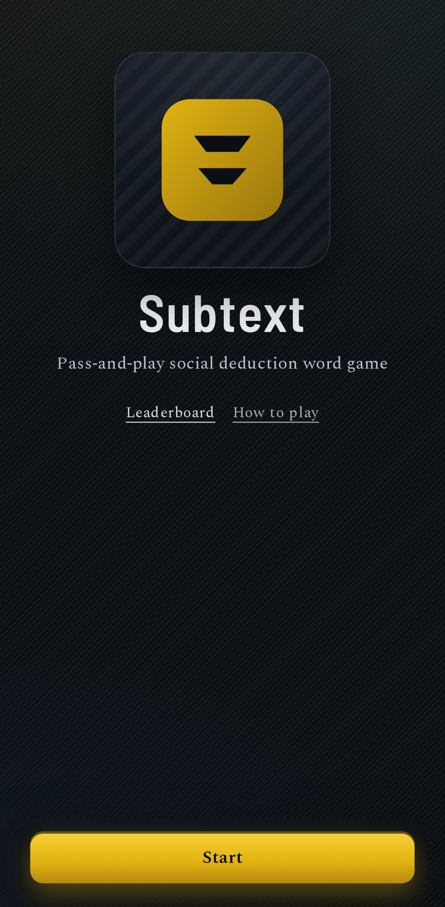
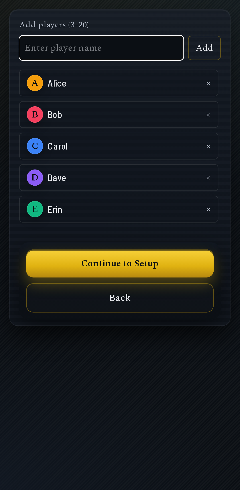
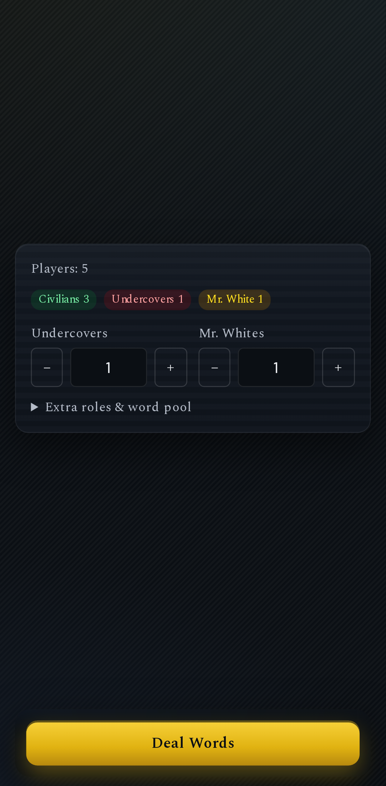
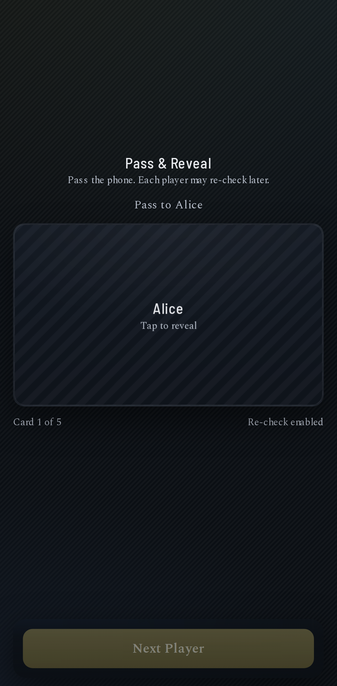
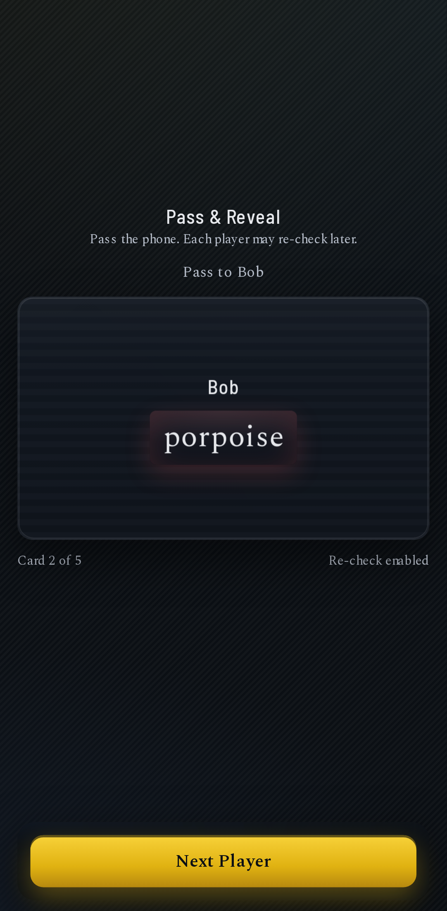
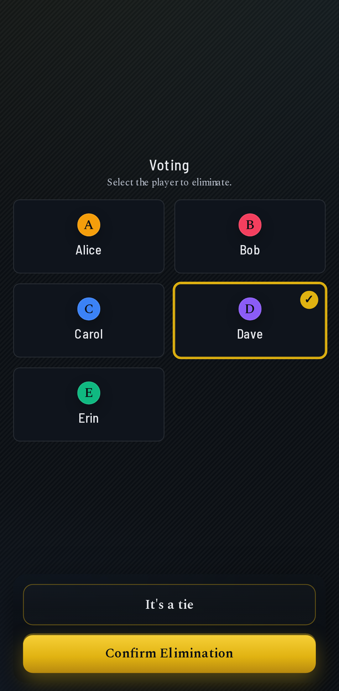
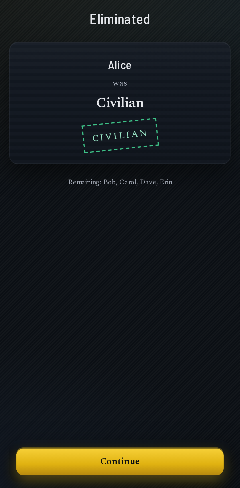
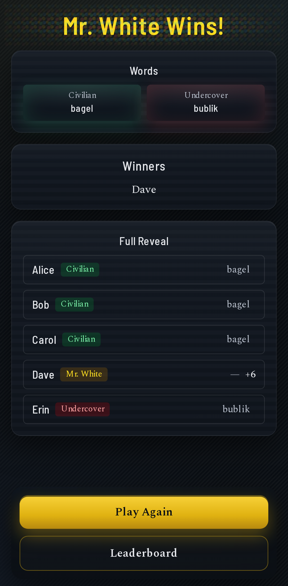

# Subtext

[](https://nextjs.org) [](https://www.typescriptlang.org/) [](https://tailwindcss.com/) [](https://web.dev/progressive-web-apps/) [](LICENSE)

Pass-and-play social deduction word game — free, ad‑free, offline, and installable on iPhone as a PWA.

## Screenshots

<table>
  <tr>
    <td></td>
    <td></td>
    <td></td>
    <td></td>
  </tr>
  <tr>
    <td></td>
    <td></td>
    <td></td>
    <td></td>
  </tr>
</table>

## Features

- **Offline-first PWA**: installable on iPhone; works without network after first load
- **Pass‑and‑play**: one device, local rounds with any group size (3–20)
- **Beautiful UI**: polished, readable dark theme with large touch targets
- **Word pools**: curated civilian/undercover pairs; optional extra roles
- **Fully tested**: Vitest unit tests and Playwright end‑to‑end flows

## How to play

- **Civilians** all share the same secret word (e.g., “bagel”).
- **Undercover** gets a similar word (e.g., “bublik”) and tries to blend in.
- **Mr. White** gets no word — they improvise, and if eliminated can win by guessing the Civilians’ word.
- Everyone, in turn, says a one‑word clue. Then vote to eliminate. Repeat until a team wins.
- **Scoring**: Civilians +2, Mr. White +6, Undercover +10. Optional extra roles are available but off by default.

## Tech stack

- Next.js 16 (App Router) + TypeScript
- Tailwind CSS
- next-pwa for offline support and installability
- Vitest + Playwright for tests

## Getting started

```bash
# Install dependencies
npm install

# Run dev server
npm run dev

# Unit tests (Vitest)
npm test

# End-to-end tests (Playwright)
npx playwright install --with-deps
npm run test:e2e
```

## Deploy

Vercel is recommended.
- Import the repository and select the **Next.js** preset.
- No environment variables are required.

## Add to iPhone Home Screen

- Open in Safari, tap the Share button, then “Add to Home Screen”.
- Launch from the icon for a full‑screen, app‑like experience.

## Project structure

```
src/
  app/           # routes and pages
  components/    # shared UI
  data/          # word pairs
  lib/           # game engine + state
public/          # PWA icons + manifest
scripts/         # tooling and screenshot capture
```

## License

MIT © 2026 Satyajit Sriram. See [LICENSE](LICENSE).
